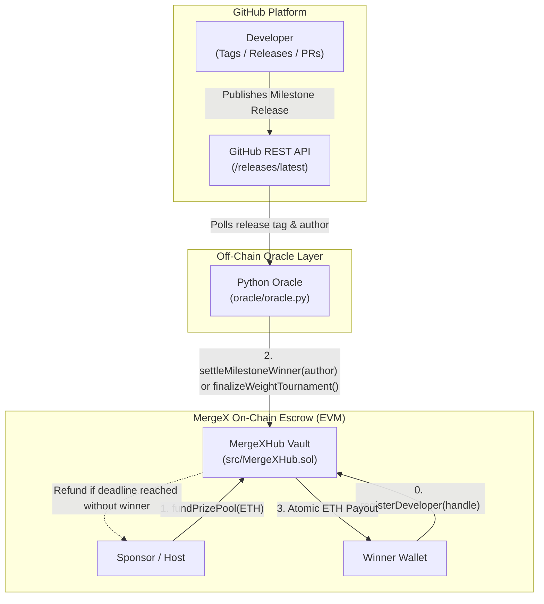

# MergeX

A decentralized bounty escrow and tournament system for open-source software. MergeX lets sponsors lock prize pools in a smart contract vault, lets developers compete on GitHub, and uses an off-chain oracle to automatically verify releases and trigger payouts without intermediaries.

---

## Tech Stack

| Layer | Technologies |
| :--- | :--- |
| **Smart Contracts** |    |
| **Oracle & Automation** |    |
| **Integration & Testing** |    |

---

## System Architecture



### Core Architecture Components

1. **`MergeXHub.sol` (Vault Escrow & Settlement)**:
   - Manages tournament lifecycles through distinct states: `Setup`, `Active`, and `Completed`.
   - Supports dual modes: **Milestone Race** (first-to-ship target release) and **Contribution Weight** (proportional / scored contributions).
   - Enforces strict role isolation (`onlyHost`, `onlyOracle`), Checks-Effects-Interactions pattern, and OpenZeppelin `ReentrancyGuard`.
2. **Oracle Bridge (`oracle/oracle.py`)**:
   - Continuously monitors repository activity via GitHub's API.
   - Verifies milestone tags against registered developer handles.
   - Signs and submits settlement transactions directly to the smart contract.
3. **Escrow Guarantee**:
   - Developers are guaranteed trustless, automatic compensation upon successful release verification.
   - Sponsors are protected by programmatic refund windows if deliverables are not met before the configured deadline.

---

## How It Works

1. **Setup & Developer Registration**:
   - The sponsor deploys `MergeXHub` configured with the trusted oracle address, tournament kind (`MilestoneRace` or `ContributionWeight`), and a duration timestamp.
   - Developers call `registerDeveloper(handle)` during the `Setup` phase to bind their GitHub handle to their EVM wallet address (write-once, immutable binding).
2. **Escrow Funding**:
   - The sponsor deposits ETH via `fundPrizePool()`, transitioning the tournament from `Setup` to `Active`. No further developer registrations are accepted once funded.
3. **Off-Chain Verification & Settlement**:
   - The Python oracle monitors the target repository releases endpoint.
   - Upon detecting the target milestone release tag, the oracle invokes `settleMilestoneWinner(author)`.
   - The contract verifies oracle authorization, resolves the author's registered payout address, transitions to `Completed`, and executes an atomic ETH transfer.
4. **Deadline & Host Refund**:
   - If no valid milestone release is verified before the deadline expires, the sponsor can call `refund()` to safely withdraw the locked prize pool.

---

## Quickstart

### Prerequisites
- [Foundry](https://getfoundry.sh/) (`forge`, `anvil`)
- Python 3.10+ & `pip`

### Getting Started

```bash
git clone <repo> && cd MergeX          # Clone the repository
pip install web3 requests               # Install Python oracle dependencies
forge build                             # Compile Solidity contracts
forge test                              # Run test suite
bash demo.sh                            # Run end-to-end demo on local Anvil
```
