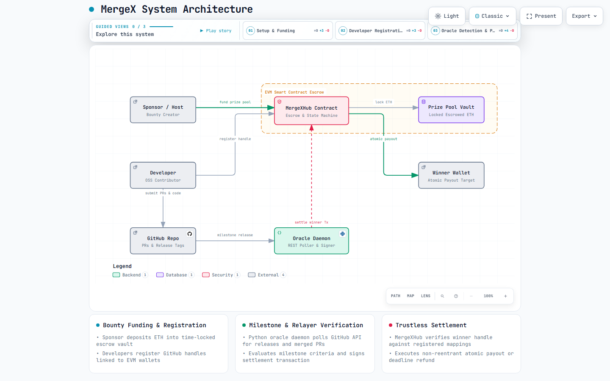
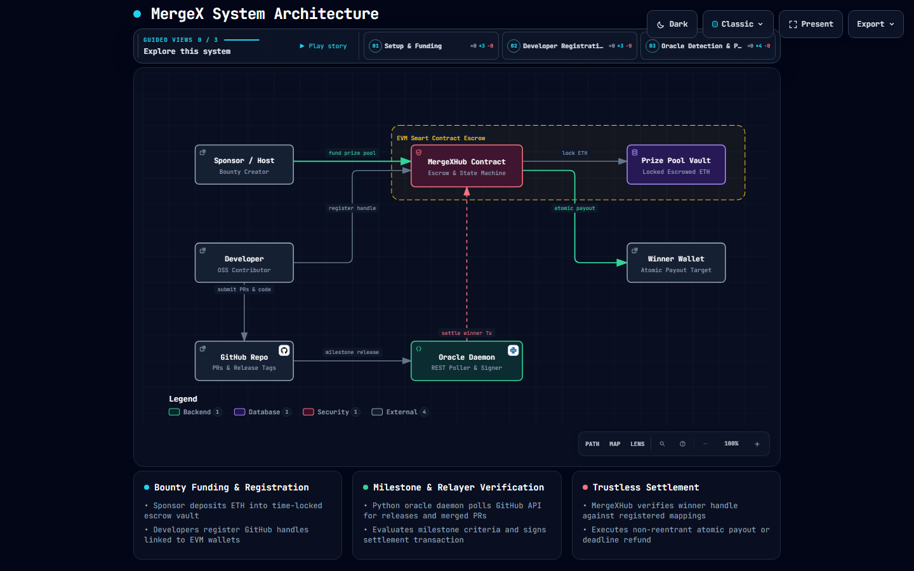

# MergeX

## Quickstart (5 lines)

```bash
git clone <repo> && cd MergeX   # clone the project
pip install web3 requests        # install Python deps
forge install                    # install Solidity deps
forge test                       # run all tests (should pass)
bash demo.sh                     # end-to-end demo on local Anvil
```

> **Requires:** [Foundry](https://getfoundry.sh) (`forge`, `anvil`, `cast`) and Python 3.9+.

---

## Architecture Diagram

The system architecture is documented with an interactive standalone HTML diagram:

- **Interactive Viewer:** [`docs/architecture/mergex-architecture.html`](docs/architecture/mergex-architecture.html)
- **Specification:** [`docs/architecture/mergex-architecture.json`](docs/architecture/mergex-architecture.json)
- **Light Preview:** 
- **Dark Preview:** 

